# BarrierRelay

**Turn a blocked moment into a repair someone can act on.** BarrierRelay is a keyboard-first Chrome extension and web app for reporting accessibility barriers: capture the control where you are stuck, draft a concise report privately with Gemini Nano, review exactly what will be shared, then ask cloud Gemini for a WCAG-informed fix plan and share a repair ticket. It connects a disabled user's experience to a site owner's next action—not just another audit score. The [WebAIM Million 2026 report](https://webaim.org/projects/million/) found detectable WCAG failures on **95.9%** of tested home pages and missing form input labels on **51% of home pages**; those are automated findings, not a measure of every accessibility barrier.

Built for #BuildHybridAI. Submission materials: [architecture](docs/ARCHITECTURE.md), [Devpost draft](docs/SUBMISSION.md), [video script](docs/VIDEO_SCRIPT.md). **Current delivery status:** run locally; Firebase Hosting is configured for `barrierrelay-lpun3.web.app` but is not yet deployed (status supplied in [the docs task spec](specs/i-docs-pi.md)). No public live-demo availability is claimed here.

## Judge quick-start: no extension required

After completing the Firebase configuration below:

```sh
npm install
npm run dev --workspace=@barrierrelay/web
```

Open **http://127.0.0.1:5173/report?fixture=02-icon-pay-button&variant=broken**. The synthetic checkout includes a keyboard-focusable payment button with no accessible name ([fixture source](fixtures/pairs/02-icon-pay-button/broken.html)). Create a private draft, review/edit it, run self-check, inspect the shared JSON, request a fix plan, and create a shareable ticket. The preparation button for Nano is on the [home page](http://127.0.0.1:5173/); prepare there before opening the report.

- With Nano available, the draft uses real on-device AI.
- If the SDK reports Nano unavailable, the UI offers the implemented **rules-only draft** path and labels it honestly; no automatic cloud fallback receives the raw capture.
- For a deterministic UI walkthrough, append `&demo=1` to the report URL. **This mode uses no AI, including no cloud AI. It still initializes Firebase and writes real Firestore tickets when you choose to share.** It is not evidence of hybrid inference ([services](apps/web/src/services.ts), [demo pipeline](apps/web/src/dev/fakePipeline.ts)).

## Why hybrid: different capabilities, different trust boundaries

| Step | Where it runs | Why |
| --- | --- | --- |
| Region capture, accessible names, key trail, axe rules | Local browser code; no inference | Reproducible facts without uploading a page or recording typed field values. |
| Raw facts + cropped image → editable draft | Gemini Nano through Firebase AI Logic, `ONLY_ON_DEVICE` | Raw context can be sensitive; local structured output is constrained with `responseConstraint`. |
| Draft self-check | Deterministic local checks, plus `ONLY_ON_DEVICE` when available | Check target references, rule consistency, and likely personal-data patterns before sharing. |
| Redaction and JSON review | Local code and reporter | The reporter sees the exact application-data payload before requesting cloud work. |
| Fix plan | Cloud Gemini through Firebase AI Logic, `ONLY_IN_CLOUD` | Google Search grounding can consult current W3C guidance; this is a tool capability, not merely a larger-model rewrite. |
| Ticket storage and repair status | Firebase Auth + Firestore | A shareable, approved report becomes a repair workflow. |
| Re-check | Local rule results; verification outcome stored in Firestore | A reported repair must be checked again, not inferred from generated advice. |

Implementation: [pipeline](apps/web/src/ai/pipeline.ts), [redaction](apps/web/src/privacy/redact.ts), [shared contracts](packages/shared/src/schema.ts). Grounding can be disabled by Remote Config; sources are shown only when the API actually returns grounding metadata. There is no implemented URL-context tool. The UI's routing table reports execution location from `response.inferenceSource`, elapsed time, and approved-payload bytes—not a network packet capture.

```mermaid
flowchart LR
  Page[Blocked website] --> Ext[Keyboard-first MV3 extension]
  Ext -->|one-time browser-local handoff| Intake[Web app capture intake]
  Fixtures[Synthetic fixtures] --> Intake
  Intake -->|raw facts + image stay local| Nano[Gemini Nano / ONLY_ON_DEVICE]
  Intake --> Rules[Local rules fallback]
  Nano --> Review[Edit / self-check / redact / JSON review]
  Rules --> Review
  Review -->|reporter-approved JSON only| Cloud[Cloud Gemini / ONLY_IN_CLOUD + Search]
  Cloud --> Plan[Fix plan + returned sources]
  Review -->|explicit ticket creation| Store[(Firestore)]
  Plan --> Store
  Store --> Owner[Owner link / acknowledge / mark fixed]
  Owner --> Verify[Reporter re-capture or synthetic fixed fixture]
  Verify -->|verification result| Store
```



## Privacy boundaries

- **Never included in the cloud AI payload or Firestore ticket:** the region PNG, raw `CaptureFacts` object, original `userNote`, page title, full HTML, or original query/fragment. The extension itself never uploads a capture.
- The collector does not read form values or record typed characters. Its optional navigation trail contains only Tab, Shift+Tab, Enter, Space, Escape and virtual focus references. **A screenshot can still visibly contain sensitive information.** It stays local; review your draft and shared JSON.
- Accessible names and rule details **are included** after pattern-based scrubbing. Page path, visible text, and focus trail are optional and off by default. Pattern matching is not a guarantee that all personal information is removed, including information copied into an edited draft.
- On-device processing never silently switches to cloud. Unavailable Nano leads to a labeled local-code fallback or an error. Preparing/downloading a model is a separate user action.
- “Private capture” does **not** mean the web app makes no network requests: Firebase initialization, anonymous Auth, App Check/reCAPTCHA, Remote Config, static assets, explicitly requested cloud inference, and ticket writes use network services. Site origin and approved content are shared when requested.
- Ticket links are bearer-like sharing links, **not owner-authenticated access control**: any Firebase-signed-in user with a ticket ID can read it and advance permitted status transitions. Listing is restricted to the reporter's own tickets. Do not submit sensitive reports to this prototype.

See [data flow and rule details](docs/ARCHITECTURE.md) and [extension permissions/privacy](extension/README.md).

## Setup

### Dependencies and Firebase

Use a current Node.js/npm installation (the project environment is documented in [PROJECT.md](docs/PROJECT.md)). From the repository root run `npm install`. Copy no credentials into tracked files.

Create `apps/web/.env.local` with the following **key names**, using your Firebase web app's public configuration and reCAPTCHA Enterprise site key:

```dotenv
VITE_FB_API_KEY=
VITE_FB_AUTH_DOMAIN=
VITE_FB_PROJECT_ID=
VITE_FB_STORAGE_BUCKET=
VITE_FB_MESSAGING_SENDER_ID=
VITE_FB_APP_ID=
VITE_RECAPTCHA_ENTERPRISE_SITE_KEY=
# Optional; defaults to the stable unpacked extension ID documented below:
VITE_EXTENSION_ID=
```

These names match [firebase.ts](apps/web/src/firebase.ts) and [intake.ts](apps/web/src/capture/intake.ts). Firebase web configuration is public client configuration, **not** an Admin SDK/service-account credential. Security comes from Firebase rules and App Check, not hiding a web API key.

Your Firebase project needs Firebase AI Logic using the Gemini Developer API backend, anonymous Auth, Firestore, App Check with reCAPTCHA Enterprise, and Remote Config. Register development/production domains with the provider. The supplied project has App Check **enforced for AI Logic** and deployed Firestore rules, per [coordinator-verified setup facts](specs/i-docs-pi.md); Firestore App Check enforcement is not asserted. Defaults and the template are in [config.ts](apps/web/src/config.ts) and [remoteconfig.template.json](remoteconfig.template.json). Provider/model access and billing/quota must support the configured cloud model; its default name is configuration, not proof of availability.

**Local App Check debug token:** register a locally generated debug token in Firebase Console → App Check → your web app → Manage debug tokens, following the [official debug-provider instructions](https://firebase.google.com/docs/app-check/web/debug-provider). Store it only in ignored `apps/web/.env.development.local` as `VITE_APPCHECK_DEBUG_TOKEN=<your locally registered token>`, then restart Vite. The code enables it only in development. Do not paste it into tickets, screenshots, logs shared with others, production builds, or Git. Never open or copy another developer's existing token file. Vite loads this local file automatically.

### Chrome and Gemini Nano

Use a supported desktop Chrome browser with Prompt API text/image and structured-output support, a secure context (loopback development or HTTPS), eligible hardware/disk, and a downloaded model. See [Chrome requirements](https://developer.chrome.com/docs/ai/get-started) and [Firebase hybrid inference](https://firebase.google.com/docs/ai-logic/hybrid-on-device-inference?platform=web). Chrome feature availability is build/profile dependent; unsupported browsers retain the rules-only path.

The development machine uses Chrome **158**, verified in [Gate 0](gate0/NANO_NOTES.md). That historical document records an **initial failed download** on a metered hotspot; it is not the final model status. Later coordinator probes confirmed Nano image and constrained-JSON inference on this machine ([evidence status](docs/ARCHITECTURE.md#evidence-and-release-gates)). Prepare on an unmetered connection and click **Prepare private on-device AI** from the app home page: `initializeDeviceModel()` requires a real user gesture. Do not force a large model download over someone else's hotspot.

For a dedicated experimental Chrome profile, the feature arguments actually used by the local runner are documented in [Gate 0 launch arguments](gate0/NANO_NOTES.md#reusable-runner) and implemented in [tools/nano/run.mjs](tools/nano/run.mjs). With Vite running and this dedicated profile closed, the equivalent manual launch is:

```sh
/opt/google/chrome/chrome \
  --user-data-dir="$HOME/.cache/barrierrelay/chrome-nano" \
  --enable-features=OptimizationGuideOnDeviceModel:BypassPerfRequirement/true,OptimizationGuideManifestBroker,OptimizationGuideModelExecution,OptimizationGuideModelDownloading,OptimizationHints,AIPromptAPI,AIPromptAPIMultimodalInput,AIPromptAPIStructuredOutput,AIPromptAPILegacyParams,PromptAPIForGeminiNano,PromptAPIForGeminiNanoMultimodalInput \
  --no-first-run --no-default-browser-check \
  http://127.0.0.1:5173/
```

Enable **Prompt API** and **Prompt API Multimodal Input** in builds that expose those flags; experimental flags do not guarantee eligible hardware or model availability. Do not reuse or kill an unrelated Chrome profile, and do not run the standalone runner concurrently against this profile. A standalone probe is available:

```sh
npm ci --prefix tools/nano
node tools/nano/run.mjs --prompt 'Reply with the word OK'
node tools/nano/run.mjs --prompt 'Return an object with answer OK' --schema tools/nano/example-schema.json
```

**Offline scope:** preload the app/capture and prepare the model while online, then test drafting in that already-open tab with networking disabled. The app does not currently install an offline app-shell service worker; fresh offline navigation, Auth initialization, model download, grounding, and ticket storage are not promised. TODO(verify): record an end-to-end offline draft through the real Firebase AI Logic app path before claiming the full offline demo is proven.

### Unpacked extension

```sh
npm --prefix extension run build
```

Open `chrome://extensions`, enable Developer mode, and load `extension/dist/`. Reload the page to start local navigation-key recording. Stable ID: **`ehiihcegnfekjkifcjmebdgiijpepdkp`** ([public key/build](extension/key.json)). Focus the blocked control, then press **Alt+Shift+B** or use the toolbar action. Fill in your goal and submit. Options choose either local origin `http://127.0.0.1:5173` or the configured hosted origin; no other origins can retrieve a capture. See [extension/README.md](extension/README.md) for permissions, shortcut conflicts, frame restrictions, and keyboard/pointer selection details.

## Run, build, test

All commands below run from the repository root. Script names are defined in [root package.json](package.json), [web package.json](apps/web/package.json), [collector package.json](packages/collector/package.json), and [extension package.json](extension/package.json).

```sh
# Generate captured facts and PNGs for the existing synthetic fixture pages:
npm run fixtures:build

# App dev/build/preview (dev and build automatically copy fixtures into public/):
npm run dev --workspace=@barrierrelay/web
npm run build --workspace=@barrierrelay/web
npm run preview --workspace=@barrierrelay/web

# All web Vitest tests; or just extension intake tests:
npm run test --workspace=@barrierrelay/web
(cd apps/web && npx vitest run src/capture)

# Collector browser/privacy checks:
npm run test --workspace=@barrierrelay/collector

# Isolated extension integration test; requires installed Chrome:
npm --prefix extension run build
node tools/e2e/extension.e2e.mjs

# UI repair-loop E2E: deterministic AI substitute, REAL Firebase ticket writes:
node tools/e2e/web.e2e.mjs

# Optional real Nano evaluation, only after a model is already available:
node gate0/eval/run-eval.mjs
```

The browser tools currently use `/opt/google/chrome/chrome`. The extension E2E uses a fresh temporary profile and a report stub, not the app UI. The web E2E uses `demo=1`, writes synthetic tickets, and does not validate real AI inference. Tests must not be described as an accessibility certification or a production security audit. The [Nano evaluation script](gate0/eval/run-eval.mjs) emits results under ignored `gate0/out/`; do not publish accuracy/latency claims without retaining the actual run artifacts and conditions.

## Scope and limitations

Implemented barrier categories include unlabeled inputs, unnamed buttons, unnamed links, keyboard-unreachable controls, and missing focus indicators; keyboard-trap assessment also depends on the captured trail and reporter context ([rules](apps/web/src/ai/rules.ts)). Detection is scoped, heuristic, and incomplete. A `none` result does not establish accessibility.

- **Not a WCAG compliance certifier.** AI guidance, automated rules, and a passing target re-check do not replace disabled-user testing or a full audit.
- The collector caps the region's facts and navigation history; it may miss the relevant control on a complex page. Cross-origin frames and browser UI are not covered. See [schema limits](packages/shared/src/schema.ts) and [extension behavior](extension/README.md).
- Generated code is illustrative, not applied automatically. Returned grounding links can be absent or need human verification; the prompt asks for W3C guidance but does not enforce a domain allowlist.
- Fixed-fixture verification is explicitly synthetic. Live re-capture checks target references and rules, not an independent semantic proof that the same real control was repaired; virtual refs are capture-local.
- No authenticated owner identity, abuse-resistant collaboration roles, ticket deletion UI, or cross-device anonymous-account recovery is implemented. Model quality, production browser coverage, and a disability-led usability study remain release work.

## License

Original code: [Apache License, Version 2.0](LICENSE). Third-party notices and differing dependency licenses: [NOTICE](NOTICE), including axe-core (MPL-2.0), dom-accessibility-api (MIT), Firebase (Apache-2.0), and Preact (MIT). Dependency metadata and the lockfile are the sources for resolved versions and licenses.
